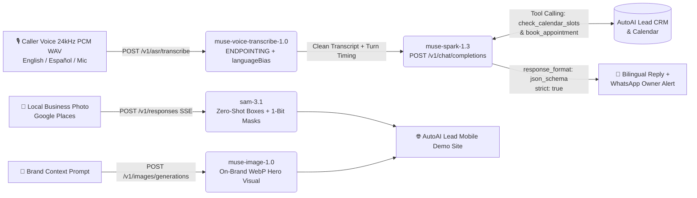

# AutoAI Lead — 24/7 Bilingual AI Receptionist & Visual Demo Engine

[](https://meta.autoailead.com)
[](https://autoailead.com)
[](https://app.autoailead.com/d/smile-dental)
[](./LICENSE)

Built for the **Meta Global AI Developer Hackathon (Oct 26 – Nov 4, 2026 · Startup Track · Theme: *Build for Your World*)**.

- **Live Hackathon Demo:** [https://meta.autoailead.com](https://meta.autoailead.com)
- **Health & Spend Telemetry API:** [https://meta.autoailead.com/api/health](https://meta.autoailead.com/api/health)
- **Production SaaS:** [https://autoailead.com](https://autoailead.com) · [Sample Local Business Demo Site](https://app.autoailead.com/d/smile-dental)

---

## 1. The Problem We Know Firsthand (*Build for Your World*)

Since 2024, our agency (**PubliExpert LLC**) has served 200+ small businesses across the US and Latin America. Local service businesses (dentists, HVAC contractors, clinics, plumbers) lose their highest-margin leads in two places:
1. **No web presence or a broken website**, so cold outreach from agencies gets ignored unless the owner can *see* their own business online first (**AutoAI Lead** solves this by generating instant mobile demo sites from Google Places data).
2. **Missed calls and slow lead response**—especially after hours or when a customer calls in Spanish or code-switched Spanglish during an emergency.

**AutoAI Lead — AI Receptionist & Visual Demo Engine** chains **four Meta Model API models (`https://api.meta.ai/v1`)** into a single workflow that visually upgrades a local business's demo site and answers, qualifies, and books incoming English/Spanish voice calls in seconds.

---

## 2. Chained 4-Model Meta AI Architecture



### How Each Meta Model Is Used Beyond a Basic Wrapper

1. **`muse-voice-transcribe-1.0` (`POST /v1/asr/transcribe`)**
   - Processes 24kHz mono 16-bit PCM WAV audio in `ENDPOINTING` mode with `languageBias: ["English", "Spanish"]` and domain-specific `keywords` (`Smile Dental`, `Brickell`, `AutoAI Lead`, `crown`, `muela`, `emergency`).
2. **`muse-spark-1.3` (`POST /v1/chat/completions`)**
   - **Turn 1 (Agentic Tool Calling):** Uses `tool_choice: "auto"` and `parallel_tool_calls: false` to invoke `check_calendar_slots` and `book_appointment` against the business's schedule.
   - **Turn 2 (Constrained Decoding):** Enforces `response_format: { type: "json_schema", json_schema: { name: "LeadQualification", strict: true } }` to guarantee valid JSON with urgency, detected language (`en`/`es`), booked slot, estimated ticket value in USD, caller reply, and an instant WhatsApp summary for the business owner.
3. **`sam-3.1` (`POST /v1/responses` with SSE Streaming)**
   - Streams zero-shot object detection and pixel-accurate `one_bit` segmentation masks (`<0f>0<|box;x1=...;y1=...|><|mask;x=0;y=0;data=H,W,!payload|>`) on real business photos (`dental chair`, `technician`), parsed by our custom wire-grammar parser (`parseSamSegmentationText` in `src/metaClient.js`) and rendered as interactive SVG overlays.
4. **`muse-image-1.0` (`POST /v1/images/generations`)**
   - Generates tailored `webp` hero visuals for each local business demo site at a flat `$0.01/image` (`reasoning_strength: "low"` for low-latency production rendering).

---

## 3. Verified Live Benchmarks & Cost Telemetry (`https://api.meta.ai/v1`)

All four models were benchmarked live against `https://api.meta.ai/v1` and cached in `data/runtime-cache.json`:

| Model | Endpoint | Live Calls | Avg Latency | Unit Price (Official Docs) | Cumulative Real Spend | Cache Replay Cost |
| :--- | :--- | :---: | :---: | :--- | :---: | :---: |
| **`muse-voice-transcribe-1.0`** | `POST /v1/asr/transcribe` | 4 (EN & ES WAVs) | **2,536 ms** | `$0.18 / hour` (`$0.00005 / sec`) | **`$0.002000`** | **`$0.00`** |
| **`muse-spark-1.3`** | `POST /v1/chat/completions` | 4 (Tools + JSON Schema) | **8,842 ms** | `$1.25 / 1M in` · `$0.15 / 1M cached` · `$4.25 / 1M out` | **`$0.039652`** | **`$0.00`** |
| **`sam-3.1`** | `POST /v1/responses` (SSE) | 3 (900×600 photos) | **749 ms** | `$2.50 / 1,000 images` (`$0.0025 / img`) | **`$0.007500`** | **`$0.00`** |
| **`muse-image-1.0`** | `POST /v1/images/generations` | 2 (WebP Hero Visuals) | **10,067 ms** | `$0.01 / image` flat | **`$0.020000`** | **`$0.00`** |
| **TOTAL** | **All 4 Meta Models** | **13 live calls** | — | **Out of $150.00 Hackathon Credit** | **`$0.069153 USD`** | **`$0.00 USD`** |

---

## 4. Strict Spend Guardrails (`src/guardrails.js`)

Because Meta Model API's dashboard *Spend Limit* is an email notification rather than a hard billing cutoff, we engineered a **hard code-level spend guardrail**:
- **Content-Addressed SHA-256 Cache (`data/runtime-cache.json` + SQLite):** Every request (prompt, audio SHA-256, image hash) is stored on disk. Judges and users re-running the 4 verified bilingual scenarios trigger **0 network cost ($0.00 USD)** with sub-10ms response times.
- **Hard Total Cap (`MAX_TOTAL_SPEND_USD=5.00`) & Per-Session Cap (`MAX_SESSION_SPEND_USD=0.50`, `MAX_CALLS_PER_SESSION=15`):** Checked before any HTTP call leaves the server.
- **Zero-Error Bilingual Fallback:** If `META_API_KEY` is omitted or a session cap is reached, the server seamlessly serves pre-verified EN/ES outputs so the production demo never breaks.

---

## 5. Run Locally in 60 Seconds

Zero external npm dependencies required (runs natively on **Node.js 20+**):

```bash
git clone https://github.com/nathanro/autoailead-meta-receptionist.git
cd autoailead-meta-receptionist

# Optional: add your Meta Model API key for new uncached inputs
# (All 4 EN/ES Dental & HVAC scenarios work out-of-the-box from data/runtime-cache.json)
cp .env.example .env

# Run the unit test suite (pricing calculator, SAM 3.1 wire grammar parser, spend guardrails)
npm test

# Start the server on http://localhost:3080
npm start
```

## License

MIT © 2026 Nathan Romano (PubliExpert LLC)
